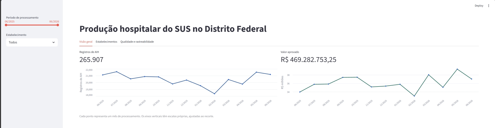

# Business Intelligence na gestão hospitalar pública do Distrito Federal

Repositório da versão avaliada do TCC II, com aplicação Streamlit, dados públicos agregados do SIH-SUS e CNES, processamento e evidências de verificação. O recorte corresponde a 13 competências, de junho de 2025 a junho de 2026.

## Visão do painel



## Execução

Com Python 3.12, abra o PowerShell na raiz deste repositório:

```powershell
cd versao_avaliada
py -3.12 -m venv .venv
.\.venv\Scripts\python -m pip install -r requirements.txt
.\.venv\Scripts\python verificar.py
.\.venv\Scripts\python -m streamlit run app.py
```

## Documentação e evidências

- [README da aplicação](versao_avaliada/README.md)
- [Implementação e dados](versao_avaliada/docs/implementacao.md)
- [Reconstrução a partir dos arquivos originais](versao_avaliada/docs/reproducao.md)
- [Manifesto dos arquivos públicos](versao_avaliada/processamento/manifesto_publico.csv)
- [Evidências da aplicação e testes](versao_avaliada/evidencias/)
- [Conciliação TABNET](versao_avaliada/conciliacao/)

O painel usa os CSVs agregados distribuídos neste repositório. A reconstrução integral exige os arquivos originais, conforme o procedimento documentado. Os indicadores são descritivos e não substituem sistemas oficiais nem avaliações clínicas ou institucionais.
